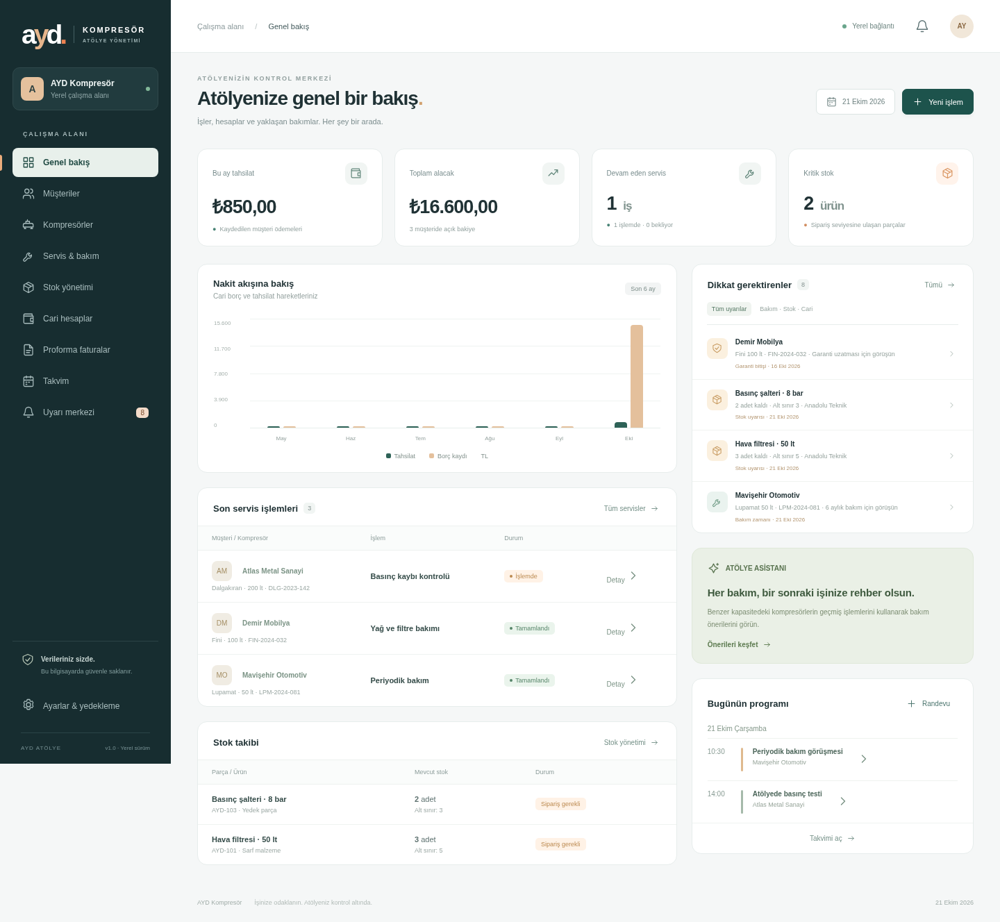

# AYD Kompresör · Atölye yönetimi

Kompresör satış ve tamir işletmeleri için Türkçe, yerel veri kullanan ilk çalışan sürüm. Müşteri, makine, servis, stok, cari hesap, proforma ve randevular aynı SQLite veritabanında tutulur. Arayüz hiçbir harici font, CDN veya bulut servisine ihtiyaç duymaz.

## Çalıştırma

Python **3.12 veya üzeri** yeterlidir. Çekirdek uygulamanın harici Python veya Node bağımlılığı yoktur.

```sh
cd /workspace/aydkompresor47
python3 desktop.py --browser
```

Windows'ta kaynak koddan tarayıcı sürümü: `py -3.12 desktop.py --browser`.

Masaüstü pencere sürümü için Windows'ta önce `py -3.12 -m pip install -r requirements-desktop.txt`, ardından `py -3.12 desktop.py`. Pencere Microsoft Edge WebView2 Runtime gerektirir. Tarayıcı sürümü aynı veritabanını ve iş kurallarını kullanır.

Gerçek kullanım boş başlar. Örnekleri görmek için **ayrı veri alanındaki demo**:

```sh
AYD_DATA_DIR=/workspace/aydkompresor47/.data python3 desktop.py --demo --browser
```

`--demo` normal veriyi doldurmaz; veri dizinindeki `demo/` alt klasörünü kullanır. `--headless` tarayıcı açmaz ve oturum adresini terminale yazar. Oturum adresini paylaşmayın. `--port 8765` ile sabit bir yerel port seçilebilir; varsayılan boş port otomatik seçilir. İşlem kapanınca yerel sunucu durur. Tarayıcı modunda kapatmak için terminalde Ctrl+C kullanın.

## Windows EXE

Windows 10/11 ve Python 3.12 kurulu bilgisayarda `Windows-EXE-Olustur.bat` dosyasını çalıştırın. Script sanal ortamı kurar, testleri çalıştırır ve `dist/AYD-Kompresor.exe` üretir. EXE hedef bilgisayarda Python istemez; **Microsoft Edge WebView2 Runtime** gerektirir. WebView2 bulunmayan makinelerde Microsoft'un resmi kaynağından kurun. EXE kod imzalı değildir; imzalama sertifikası bu projede bulunmaz.

Alternatif olarak depoyu GitHub'a aktardıktan sonra Actions → **Windows EXE** → **Run workflow** ile Windows derlemesini başlatıp artifact dosyasını indirin. Bu iş akışı elle çalıştırılır; GitHub'a yüklemek Windows derlemesini kendiliğinden başlatmaz.

**Linux ortamındaki testler Windows EXE'nin oluşturulduğunu veya Windows'ta açıldığını kanıtlamaz.** Windows derlemesi ve hedef bilgisayarda pencere açılışı ayrıca doğrulanmalıdır.

## Kullanılabilir iş akışları

- Müşteri oluşturma/düzenleme; iletişim, vergi no, adres, notlar ve müşteri kartında bakiye, makineler, servis ve cari geçmişi.
- Kompresör marka/model, seri no, tank kapasitesi ve garanti bitişi; garanti uzatma sonrası bitiş tarihi düzenlenebilir.
- Servis kaydı, yapılan işlemler, parça listesi, toplam servis bedeli ve sonraki bakım aralığı. Bekleyen/işlemde servisler sonradan tamamlanabilir. Tamamlanan servis stok ve cari hesabı **tek veritabanı işlemiyle** günceller.
- Stok kartları, kategori, tedarikçi, alış/satış fiyatı, açılış adedi ve alt sınır; açıklamalı stok giriş/çıkışı ve hareket geçmişi. Stok adedi eksiye düşmez. Adetler tam sayıdır.
- Cari borç/tahsilat, vade takibi, müşteri avansları. Tahsilatlar vade sırasıyla borçlara dağıtılarak geciken bakiye hesaplanır. Kesinleşen hareketler değiştirilemez; hata düzeltmesi için açıklamalı karşı hareket girilir.
- Çok kalemli ve kalem bazında KDV oranlı proforma; yazdırma/PDF çıktısı. Proforma stok/bakiye etkilemez. Satışa dönüşüm bağlı stokları düşürür ve KDV dahil cari borç oluşturur; ikinci kez dönüşüm engellenir.
- Randevu takvimi; müşteri bağlantısı, saat ve tamamlanma durumu.
- Stok, vadesi geçmiş cari, garanti ve bakım uyarıları. Garanti/bakım için geçmiş tarihler ve gelecek **30 gün** dikkate alınır. Bakımda makinenin **en son tamamlanmış servisi** esas alınır. Uygulama açıkken 60 saniyede yenilenir; kapalıyken arka plan bildirimi, SMS veya e-posta göndermez.
- Geçmişe dayalı atölye asistanı: aynı kapasitedeki **diğer** kompresörlerin tamamlanan servislerini getirir, aynı markayı önce sıralar. Kaynak servis/tarih/işlemler gösterilir. Bu bir üretici teknik teşhisi veya eğitilmiş yapay zekâ modeli değildir. Harici AI API'si kullanılmaz.
- Açılışta günlük otomatik yedek, son 14 açılış gününün yedeği ve istenildiğinde tutarlı SQLite yedeği indirme.

## Veri konumu ve geri yükleme

- Windows: `%LOCALAPPDATA%\AYD Kompresor\ayd.sqlite3`
- Linux: `~/.local/share/ayd-kompresor/ayd.sqlite3` (`XDG_DATA_HOME` varsa ona uyar).
- macOS: `~/Library/Application Support/AYD Kompresor/ayd.sqlite3`.
- `AYD_DATA_DIR` ile başka dizin kullanılabilir. Bulut geliştirmede `/workspace/aydkompresor47/.data` kullanın.
- Açılış yedekleri aynı dizindeki `backups/` klasöründedir. Demo, ayrı `demo/` klasöründedir.

**Yedek alma:** Ayarlar → Şimdi yedek indir. SQLite backup API'si kullanılır; açık WAL veritabanı dosyasını elle kopyalamak gerekmez. Yedeği ayrıca harici diskte saklayın; aynı diskteki otomatik yedek disk arızasına karşı koruma sağlamaz.

**Geri yükleme:** Tüm uygulama pencerelerini ve terminal süreçlerini kapatın. Veri dizininin tamamını ayrı bir klasöre kopyalayın. `ayd.sqlite3` ve varsa `ayd.sqlite3-wal`, `ayd.sqlite3-shm` dosyalarını mevcut dizinden kaldırıp koruduğunuz klasörde tutun. İndirilen yedeği veri dizinine `ayd.sqlite3` adıyla koyun ve uygulamayı açın. Çalışan uygulamanın veritabanını değiştirmeyin.

Bu sürüm tek işletme/tek bilgisayar kullanımı içindir; kullanıcı hesabı, rol, ağ paylaşımı ve veritabanı şifrelemesi yoktur. Bilgisayar oturumunu ve diski işletim sistemiyle koruyun. Yerel HTTP sunucusu yalnızca `127.0.0.1` adresini dinler; oturum çerezi, Origin/Host denetimi ve istek başlığı ile korunur. Uzaktan erişime açmayın.

## Geliştirme ve doğrulama

```sh
cd /workspace/aydkompresor47
python3 -m unittest discover -s tests -v
node --check web/app.js
```

17 otomatik test gerçek SQLite üzerinde stok/cari atomikliği, proforma dönüşümü, mükerrer işlem koruması, yetersiz stok geri alma, tarih/KDV hesapları, öneriler, bakiye/vade uyarıları, yedekten açılış ve yerel HTTP oturum güvenliğini kapsar. Node yalnızca isteğe bağlı JavaScript sözdizimi kontrolünde kullanılır, uygulamanın çalışması için gerekli değildir.

## Mimari ve mobil altyapı

`ayd/db.py` → SQLite şema ve tutarlı yedekleme. `ayd/domain.py` → arayüzden bağımsız iş kuralları ve işlemler. `ayd/server.py` → yerel JSON API ve statik arayüz. `web/` → bağımsız Türkçe HTML/CSS/JS arayüz. `desktop.py` → yerel sunucu, otomatik yedek ve masaüstü başlatıcısı.

Tutarlar veritabanında **tam sayı kuruş** olarak saklanır; giriş Decimal ile çevrilir. KDV kalem bazında kuruşa yuvarlanır. Para birimi TL'dir. Veritabanı sürümü `PRAGMA user_version=1` ile işaretlenmiştir; gelecek şema değişiklikleri için veri taşıma adımları eklenmelidir.

Mobil/bulut aşamasında domain katmanı korunabilir. Ancak bu yerel API doğrudan internete açılmaya hazır değildir: kimlik doğrulama, kullanıcı/işletme yetkileri, HTTPS, merkezi veritabanı, kimlik/çakışma yönetimi ve çevrimdışı senkronizasyon ayrıca geliştirilmelidir.

## İlk sürümün sınırları

Bu sürüm müşteri alacağı ve tahsilat odaklıdır; tam muhasebe defteri, gider/tedarikçi borcu, kasa/banka mutabakatı, resmi e-Fatura entegrasyonu, iade/iskonto/iptal belgeleri ve otomatik sipariş gönderimi içermez. Satış stok hareketini ve cari borcu kaydeder; mali fatura oluşturmaz. Servis bedeli nihai toplam olarak girilir; servis için ayrıca KDV ayrıştırılmaz. Mali belge üretimi için ayrı entegrasyon gerekir.

Tarayıcı uçtan uca testi: Playwright ve Chromium bulunan ortamda `python3 tests/ui_smoke.py`. Test kendi geçici demo veritabanını açar. Doğrulama ayrıntıları: [docs/DOGRULAMA.md](docs/DOGRULAMA.md).

Servis geçmişi olan bir kompresörün müşteri bağlantısı, eski hesap kayıtlarını korumak için değiştirilemez. Makine devir işlemi bu sürümde ayrıca desteklenmez.


